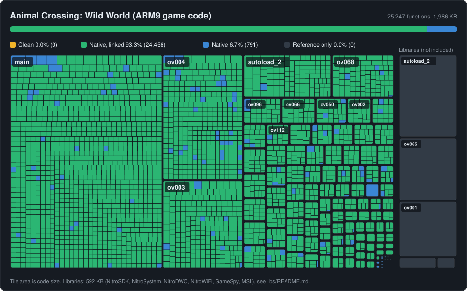

Animal Crossing: Wild World (Korea)
===================================

A matching decompilation of the ARM9 code of *Animal Crossing: Wild World*, Korean release
(`ADMK`). It does not contain any game assets, code or disassembly; you need your own copy of
the game to build it.

> [!IMPORTANT]
> **This repository contains the game's own code only.** The libraries the game links
> against (NitroSDK, NitroSystem, NitroDWC, NitroWiFi, the GameSpy SDK, the Metrowerks C
> library and runtime: 4,083 functions, about 590 KB) are not included, and show as not
> decompiled on the map below. With them, every one of the 29,328 ARM9 functions compiles to
> the ROM's exact bytes. Library versions are listed in [libs/README.md](libs/README.md).

All 25,245 game functions are C or C++ that compile with the original compiler to the ROM's
exact bytes, and the code links to the ROM's call targets and pointers. The data sections are
still taken from the ROM.

The target ROM:

- `ADMK` (Korea), SHA-1 `1fffd601d3439e37cd934e72d08e487a93fc449b`

Setup instructions are in [INSTALL.md](INSTALL.md), contribution guidelines in
[CONTRIBUTING.md](CONTRIBUTING.md), and how matches are checked in
[docs/verification.md](docs/verification.md).

Thanks to [ds-decomp](https://github.com/AetiasHax/ds-decomp),
[objdiff](https://github.com/encounter/objdiff), and the
[zeldaret](https://github.com/zeldaret), [pret](https://github.com/pret) and
[ACreTeam](https://github.com/ACreTeam/ac-decomp) projects.

Released under [CC0 1.0](LICENSE). Not affiliated with Nintendo.
