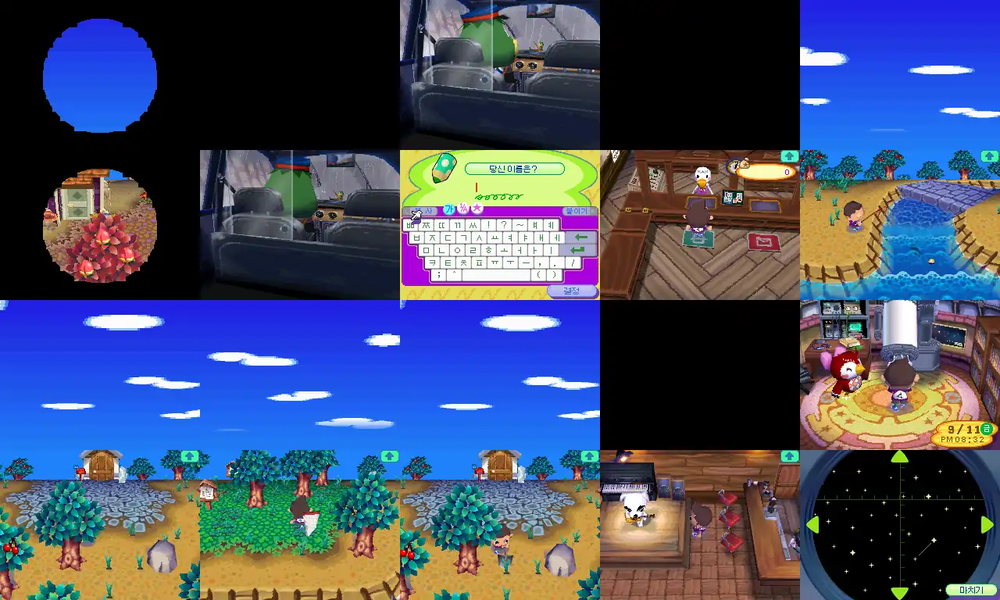
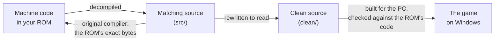
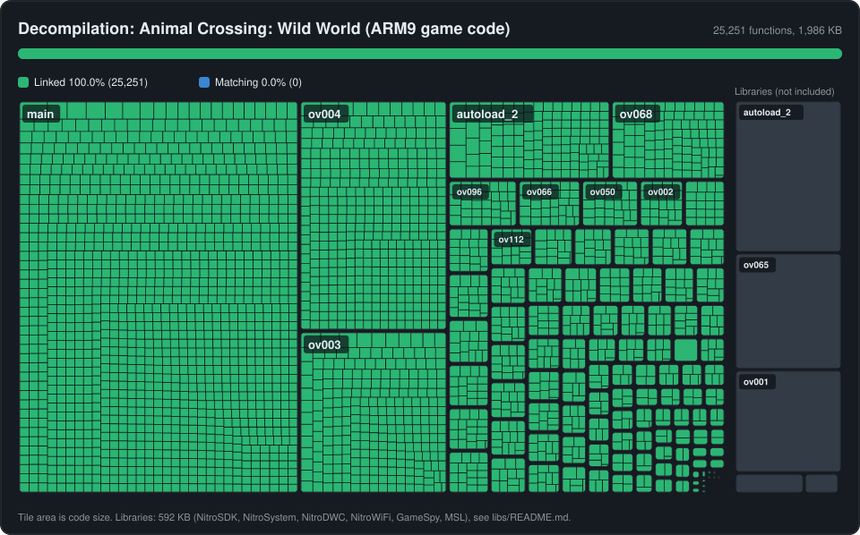
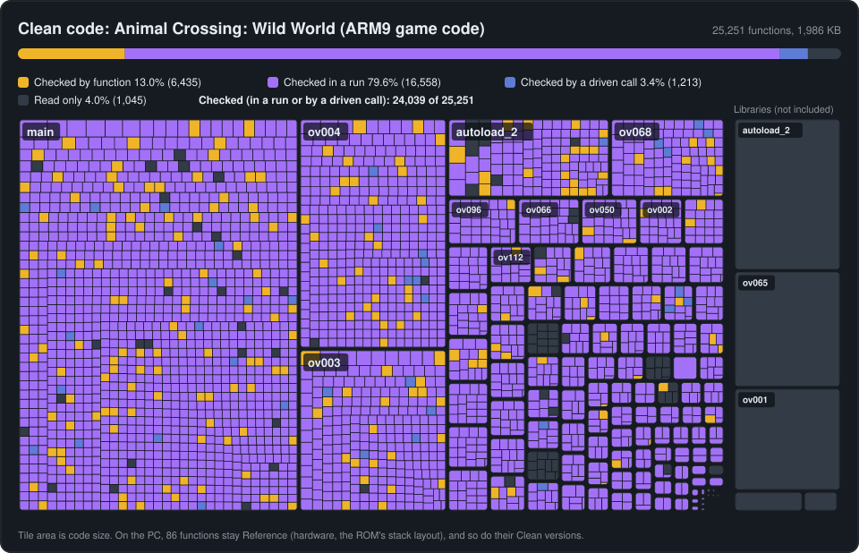

Animal Crossing: Wild World
===========================

[![Build Status]][actions]

[Build Status]: https://github.com/banatic/acww-decomp/actions/workflows/build.yml/badge.svg
[actions]: https://github.com/banatic/acww-decomp/actions/workflows/build.yml

A decompilation of the ARM9 code of *Animal Crossing: Wild World*, targeting its regional
releases, with the Korean release (`ADMK`) as the reference version. It does not contain any
game assets, code or disassembly (apart from the one short example below); you need your own
copy of the game to build it.

| Version | Code | SHA-1 | Status |
|---|---|---|---|
| Korea | `ADMK` | `1fffd601d3439e37cd934e72d08e487a93fc449b` | matched, linked and Clean complete |
| USA | `ADME` | to come | planned |
| Europe | `ADMP` | to come | planned |
| Japan | `ADMJ` | to come | planned |



*The runtime playing the game's own code from recorded input (`tools/run.py`).*

> [!IMPORTANT]
> **This repository contains the game's own code only.** The libraries the game links
> against (NitroSDK, NitroSystem, NitroDWC, NitroWiFi, the GameSpy SDK, the Metrowerks C
> library and runtime: 4,083 functions, about 590 KB) are not included. Library versions are
> listed in [libs/README.md](libs/README.md).

## How it works



One function, `func_02063f18` (36 bytes of Thumb code in the ROM), at each step. Its addresses
are the Korean release's; a function's address differs between versions.

**Machine code** (in the ROM at `0x02063f18`, 36 bytes of Thumb), as a disassembler shows it:

```asm
func_02063f18:
    push  {r4, lr}
    adds  r4, r1, #0          @ keep arg1
    bl    func_020640e0       @ p = func_020640e0(arg0)
    movs  r2, #0              @ i = 0
    b     .Lcheck
.Lloop:
    ldrb  r1, [r0, r2]        @ p[i]
    cmp   r4, r1
    bne   .Lnext
    adds  r0, r2, #1          @ return i + 1
    b     .Lreturn
.Lnext:
    adds  r2, r2, #1          @ i++
.Lcheck:
    cmp   r2, #3
    blo   .Lloop              @ while i < 3
    movs  r0, #1              @ return 1
.Lreturn:
    pop   {r4}
    pop   {r3}
    bx    r3
```

**Matching source** (`src/main/`): written so the original compiler gives back the ROM's exact
bytes. Names are still addresses.

```c
int func_02063f18(int arg0, unsigned char arg1)
{
    unsigned char *p;
    unsigned int i;
    p = func_020640e0(arg0);
    for (i = 0; i < 3; i++) {
        if (arg1 == p[i]) {
            return i + 1;
        }
    }
    return 1;
}
```

**Clean source** (`clean/main/item_group_order.c`): the same behaviour with names, types and
constants. The PC build runs it in the matching source's place.

```c
/* func_02063f18: the group (1-3) the order gives `weight`; group 1 when none does. */
int ItemGroupOrder_GroupOfWeight(u8 *order, u8 weight)
{
    const u8 *row = ItemGroupOrder_Row(order);
    for (u32 i = 0; i < ITEM_GROUP_ORDER_GROUPS; i++) {
        if (row[i] == weight) {
            return (int) i + 1;
        }
    }
    return 1;
}
CLEAN_AS(func_02063f18, ItemGroupOrder_GroupOfWeight)
```

## Part I: Decompilation (100% matching and linked)



*Decompilation: blue is Matching, green is Linked.*

The map and numbers in this part are for the Korean release.

**All 25,251 game functions are matched and linked.** Every function has a C or C++ source that
compiles with the original compiler, and the whole program, linked with the original linker,
reproduces every module of the ROM byte for byte.

- **Matching**: a C or C++ source that compiles with the original compiler (mwccarm) to the
  ROM's exact bytes, and whose calls and pointers resolve to the ROM's targets.
- **Linked**: Matching, and the whole program, linked with the original linker, also reproduces
  the module byte for byte.

The functions are regrouped into source files as the original ones held them
(`src/ov097/pockets_room.c` is one): 2,977 files of several functions, and 2,963 functions still
in a file of their own where joining them would change the code. The data sections still come
from the ROM.

## Part II: Clean code and the Windows port (100% rewritten)



*Clean code: gold is checked by function, purple is checked in a run, blue is checked by a driven call, grey is read only.*

The map and numbers in this part are for the Korean release.

Each of the 25,251 functions also has a Clean version: a readable rewrite, built for the PC
with the runtime that plays the game on Windows. The Clean versions are checked against the
ROM's code, not by matching bytes, and each function counts at the highest level it has
reached:

- **Checked by function**: the Clean version agrees with the ROM's code on generated inputs;
  this covers the functions that call nothing.
- **Checked in a run**: the Clean version ran in a recorded play run whose frames and memory
  match the ROM's code.
- **Checked by a driven call**: no path of the game calls it (a destructor of objects the game
  never deletes that way, a vtable slot no code calls), so no run can enter it; instead a
  recorded run calls it itself, on a live object at a chosen frame, and its memory right after
  matches the ROM's code ([docs/verification.md](docs/verification.md), "Driven calls"). This
  is weaker than a run: it shows the Clean version does what the ROM's code does on a real
  state, not that the game ever gets there.
- **Read only**: the Clean version has been checked only by reading it against its matching
  source. Most of these cannot run with one console (wireless, Wi-Fi Connection, another
  console's states); [docs/scene-plan.md](docs/scene-plan.md) lists them with the reason.

A function counts as **checked** when a run or a driven call has entered it, at whichever
level above it counts; the map's legend gives that number after the levels, which keep the
two kinds apart.

CI draws both maps from each build of `main` (`tools/progress_map.py`).
[docs/verification.md](docs/verification.md) describes what is checked and what is not yet.

## Quick start: your own ROM

You need your own dump of the cartridge of the version you work on, Python 3.11+ and a 32-bit
C compiler (on Windows: LLVM's clang and the Visual Studio Build Tools;
[INSTALL.md](INSTALL.md)). Then:

```sh
python tools/setup.py path/to/your-game.nds          # check the ROM, build, self-test
python tools/play.py                                 # play (Windows)
```

Every tool takes `--version <name>` (or `ACWW_VERSION`); without it, it works on the Korean
release (`adm-kr`), which is the only version configured so far.

`setup.py` checks the dump (header, region, SHA-1; a trimmed dump is padded back), extracts it
under `extract/` and `build/`, builds the PC program, and plays two recordings with the ROM's
code, the matching sources and the Clean rewrites to show this machine gives the project's
frames bit for bit. The ROM is only read; nothing taken from it leaves your machine. Matching
the original compiler's output (`--matching`) also needs mwccarm (INSTALL.md).

## Running the game on Windows

The game also runs on a PC from this repository, with each function as the ROM's code in an
interpreter (Reference), as its matching source compiled for the PC (Native), or as its Clean
version. Runs are compared with the Reference frame by frame. See
[docs/runtime.md](docs/runtime.md). `python tools/play.py` builds it with a window, live input and
the save written back, to play (Windows; [docs/play.md](docs/play.md)).

## Versions

The releases share one source tree. Only the parts that differ between them are split, by a
version condition or a per-version file; each version keeps its own configuration (symbols,
addresses, ROM hash), build, Reference runs and scenes. Clean code must do exactly what its own
version's ROM does. Only the Korean release is configured today; see
[docs/versions.md](docs/versions.md) for the design and for adding a version.

Setup instructions are in [INSTALL.md](INSTALL.md) and contribution guidelines in
[CONTRIBUTING.md](CONTRIBUTING.md).

Thanks to [ds-decomp](https://github.com/AetiasHax/ds-decomp),
[objdiff](https://github.com/encounter/objdiff), and the
[zeldaret](https://github.com/zeldaret), [pret](https://github.com/pret) and
[ACreTeam](https://github.com/ACreTeam/ac-decomp) projects.

Released under [CC0 1.0](LICENSE). Not affiliated with Nintendo.
